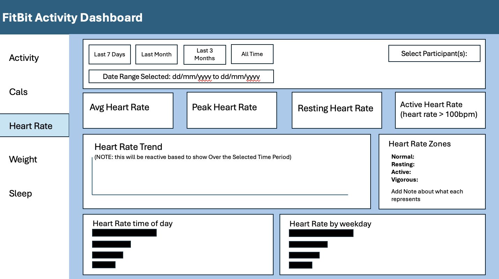

```{r setup, include=FALSE}
knitr::opts_chunk$set(echo = TRUE)
```

# TAG Team Reflection - WC 26/10/2026

\*\*NOTE: Project deadline has now been pushed back a week to 4th November 2026.

### Quality Assurance of Team members code

I carried out code reviews for two team members. I reviewed Eleanor's code for the leader board function and the activity tab. I requested some changes and she made them, and the code was then approved to merge back to the `dashboard-build` branch. I also reviewed Will's data loading functions and merged them into the `dashboard-build` branch, ready for dashboard page development.

Reviewing my team members' code showed me how much quality assurance protects the whole project. The leader board function and data loading functions are components that other pages depend on, so an error in either would have cascaded through the dashboard. Requesting changes from Eleanor meant giving feedback that was clear and constructive, and seeing her act on it and resubmit showed the process worked as a collaboration rather than a criticism. Reading other people's code also exposed me to different approaches to structuring functions, which improved my own understanding. Merging Will's work into the dashboard build moved us from individual tasks towards an integrated product, and it made me more aware of my responsibility within the project. Once I approve and merge something, I am sharing the ownership of it's quality.

I will keep reviewing code before anything merges and I will agree a short check-list with the team (for example consistent naming, comments and function inputs and outputs) so reviews are consistent and quicker. As more pages are developed, I will make sure I test merged code in the dashboard itself, not just read it, so integration problems are caught early. I will also ask for reviews of my own code, as being on the receiving end of feedback will help me understand how my comments land with others.

### **TAG Team Meeting (Microsoft Teams) - 26/10/2026**

At the meeting we used GitHub issues board to assign work to each team member, which gave everyone a clear reference point for what each person was working on. I suggested this feature because I find it useful in my own work. It lets you assign reviewers and collaborators, write comments and hold discussions around an issue, create branches directly from an issue, and break work down using sub-issues. For example, “create activity page” can be an issue with “create line plot to go on activity page” as a sub-issue.

Suggesting the issues board was a chance to bring a practice from my own work into the team and to contribute to how we organise ourselves, not just to the code. The team adopting it made me feel my input was valued. Using it gave us shared visibility, so there is less risk of duplicated effort or tasks being missed. Breaking issues into sub-issues turns large tasks into clear categories, which makes it easier to see exactly what is outstanding and to manage time more efficiently. It also links well with our code review process, because branches and reviewers can be tied to the issue they relate to. One thing I noticed is that a tool only helps if everyone keeps it up to date, so it relies on team discipline as well as the feature itself.

I will make sure my own work is tracked through issues, with sub-issues, comments and linked branches, to set a good example. I will also check the board at the start and end of each week, in line with our two weekly meetings, so we can review progress and spot blockers early. Looking ahead, I will use this approach in future team projects, as it has shown me how structured task management supports both accountability and collaboration.

### Between team meetings (27/10/2026 - 29/10/2026)

I completed the wireframe for the heart rate tab of the dashboard. I then wrote the code for the tab itself, including the date range buttons, participant filter, KPI widgets (average, peak, resting and active heart rate), the heart rate trend chart, the heart rate zones summary, and the time of day and weekday charts.

The wireframe I created for the page I was assigned is shown below:



As part of this I wrote `create_kpi_box`, a reusable function that builds KPI boxes and can be used on every page of the dashboard. It takes a title, a value, a percentage change and a “direction” setting. It handles missing, NaN or infinite values by showing “N/A” rather than letting the dashboard break, and it treats a missing percentage change as zero. It colours each box according to whether a change is good or bad: green or red for metrics where higher is better or lower is better, and a neutral blue where neither applies (as with heart rate). It also shows an arrow with the percentage change. I also wrote `fct_calculate_pct_change.R`, which calculates the percentage change that feeds the KPI boxes. It is well documented, and it is currently being reviewed by a team member before it is merged. I also reviewed more team members code during this period.

Building the wireframe first made the coding much more straightforward, because the layout, the filters and the contents of each box were already decided, and the finished tab follows it closely. That showed me the value of planning before building.

Writing the KPI box as a reusable function was the most useful part of the work. The activity, calories, weight and sleep pages all need similar KPI boxes, so one shared function keeps the dashboard consistent, and a fix or design change only needs making in one place. Designing the “direction” parameter made me think about what a KPI means for the user. A rise in steps is good news, but a rise in average heart rate is not clearly good or bad, so colouring it green or red would be misleading. I also built in handling for missing values because I expected that some participants or date ranges would have no data, and I wanted a clear “N/A” rather than an error.

I documented both functions carefully because team members depend on them, and I became more aware that code written for a team has to be understandable to people who did not write it. Having my percentage change function reviewed by someone else also put me on the receiving end of the process I have been carrying out for others, which helped me see how feedback feels from that side. Reviewing others’ code at the same time as writing my own helped me spot where my own code could be clearer.

I will respond to the review feedback on `fct_calculate_pct_change.R` promptly so it can be merged, since other pages will rely on it. I will also test the heart rate tab with different participant and date range combinations, including cases with little or no data, to check nothing breaks. I will make my definitions consistent: the resting heart rate KPI and the heart rate zones currently use different thresholds, so I will align them or add a note explaining each, as my wireframe planned. I will also check with team members that `create_kpi_box` works on their pages and extend it if they need something it doesn’t yet support. In future projects, I will keep the habit of wire framing first and writing reusable, well-documented functions early, since this saved time and made integration easier.

### **TAG Team Meeting (Microsoft Teams) - 30/10/2026**

During this team meeting, we reviewed the outstanding code awaiting pull requests and merged it all back to `dashboard-build` or `main` as required. We hit several merge conflicts along the way. Hanifah shared her screen while I talked her through what each conflict involved and how we should resolve it. We then confirmed that the dashboard ran correctly and logged the outstanding tasks to complete before next Wednesday, when we record our video presentation. I also provided information and guidance to Hanifah for writing the README.

Two conflicts we were faced with were different in kind, and that helped me understand why conflicts happens and the importance of going through it with other members in the team. The KPI box function conflict arose because I had already pushed and merged an updated version to `main`, while a teammate’s branch still contained the older version. Here the right resolution was to accept the current change, since `main` held the most up-to-date function. The `app.R` conflict was different: several of us had added our server and UI code on the same lines, so Git couldn’t tell which version to keep. In this case nobody’s work was wrong, so we accepted all changes and kept everyone’s additions. This showed me that resolving a conflict is about understanding what had changed and why.

Guiding Hanifah through this while she shared her screen worked well. Rather than resolving the conflicts myself, I explained what the conflict markers meant and why we were choosing each option. This meant she could see the reasoning and could handle similar conflicts herself in future, which strengthens the whole team’s Git skills rather than just getting one branch merged. This links to good version control practice. Conflicts in a shared entry point like `app.R` are almost inevitable when everyone adds to it at once, and the KPI conflict shows the value of telling the team when a shared function has changed so branches can be updated. 

I now feel more confident explaining merge conflicts to others, and I’d like to build on this by documenting our branching and merging approach in the README for future projects. Before the video recording next week I will check that the outstanding tasks are complete and that the dashboard still runs after the final merges, so the demo goes smoothly.
